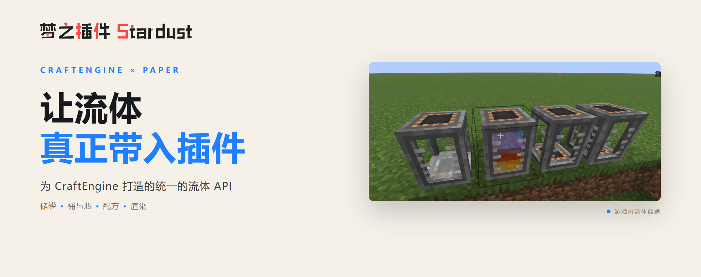

<p align="center">
   
</p>

<div align="center">

_✨统一大家庭，共创大社区✨_

</div>

<p align="center">
    <a href="https://github.com/ChengZhiMeow/nyana-fluid/issues">
        
    </a>
    <a href="https://github.com/ChengZhiMeow/nyana-fluid/blob/main/LICENSE">
        
    </a>
    <a href="https://qm.qq.com/cgi-bin/qm/qr?k=WCQEs6gMefkBOwiBIQozDQ2fvrWE7_e7&jump_from=webapi&authKey=9bW5YgQVKs1/tRmjweQbNnAUyixNGwnjUSlm/rdzHYVRHPWQbRuJDqq3020aYCct">
        
    </a>
</p>

## 导入依赖

Gradle：

```kotlin
repositories {
    maven("https://repo.catnies.top/releases")
}

dependencies {
    compileOnly("net.nyana:nyana-fluid-api:1.0.0")
}
```

Maven：

```xml
<repositories>
    <repository>
        <id>catnies</id>
        <url>https://repo.catnies.top/releases</url>
    </repository>
</repositories>

<dependencies>
    <dependency>
        <groupId>net.nyana</groupId>
        <artifactId>nyana-fluid-api</artifactId>
        <version>1.0.0</version>
        <scope>provided</scope>
    </dependency>
</dependencies>
```

## 贡献者

<a href="https://github.com/ChengZhiMeow/nyana-fluid/graphs/contributors">
  
</a>

## 精神支柱

- [Catnies](https://github.com/Catnies)

## Star

[](https://www.star-history.com/?repos=ChengZhiMeow%2Fnyana-fluid&type=date&legend=top-left)
